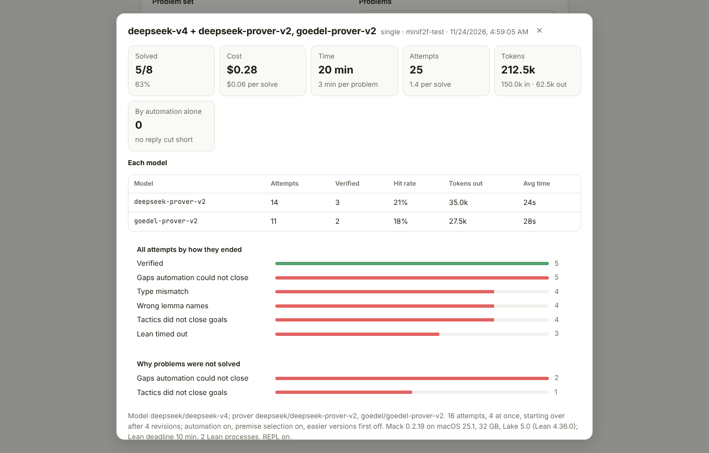
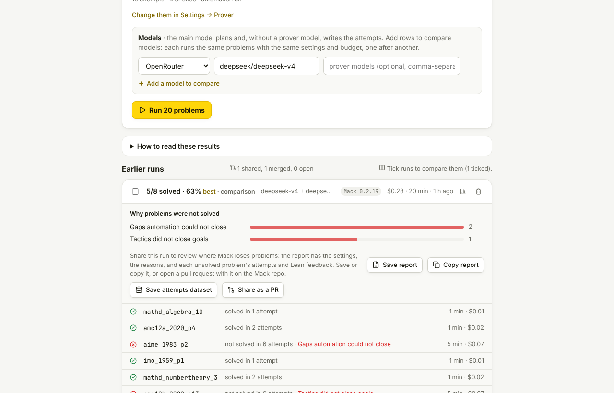
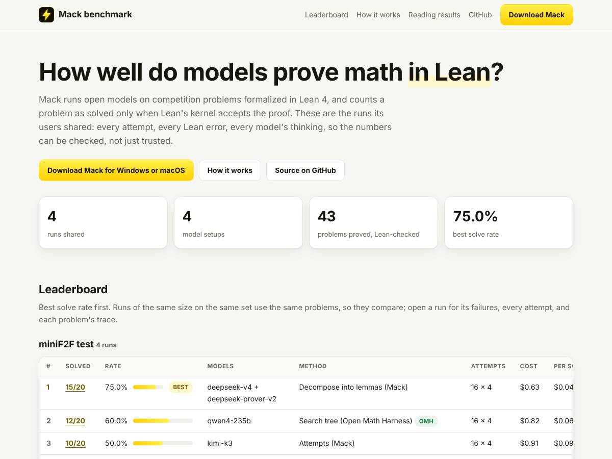
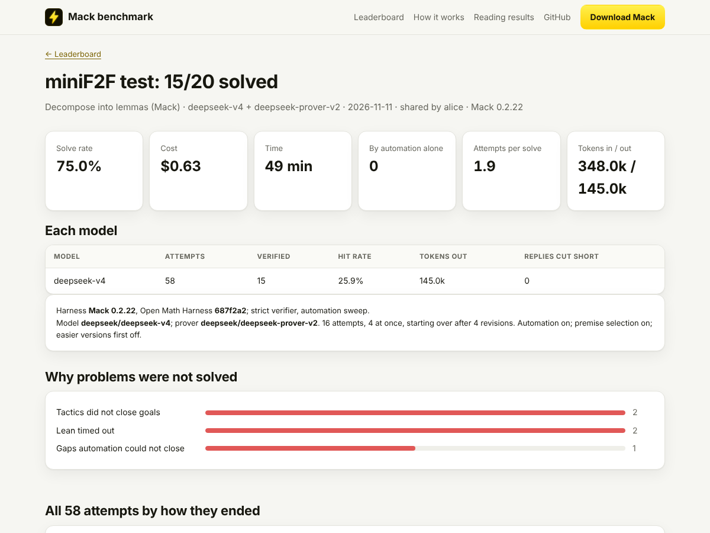
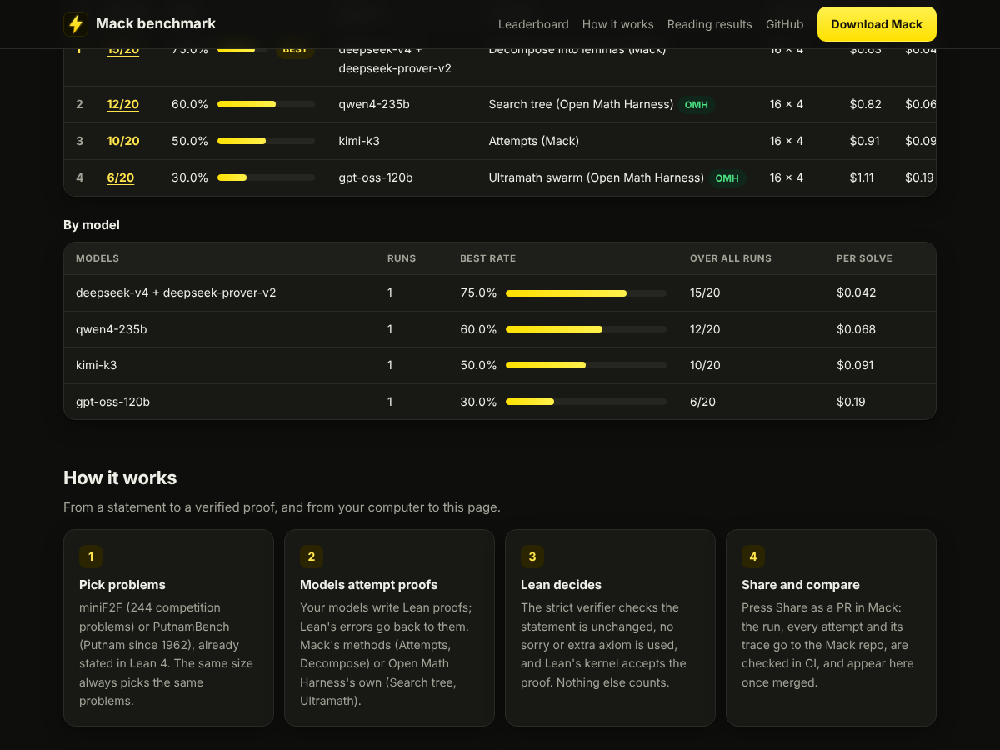

# Mack ⚡

<p align="center">
  <a href="https://github.com/JorgeOchoaReyes/Mack/releases/latest"><b>⬇ Download Mack for Windows</b></a> ·
  <a href="https://jorgeochoareyes.github.io/Mack/"><b>Benchmark leaderboard</b></a> ·
  <a href="#how-it-works">How it works</a> ·
  <a href="#contributing">Contribute</a>
</p>

A Windows desktop app for Lean-checked math research. Open models (through
[Fireworks](https://fireworks.ai), [OpenRouter](https://openrouter.ai),
[Cheaper Inference](https://www.cheaperinference.com), a
[LiteLLM](https://docs.litellm.ai) proxy or any OpenAI-compatible server) propose proofs; **Lean decides** whether they hold.

Mack follows the methodology of
[Open Math Harness](https://github.com/openmathmodel/open-math-harness), the
runtime of Open Math OS, which is Linux-only and needs the Open Math OS
deployment to run. Mack ports its methods into an app that runs on a personal
Windows machine. See [docs/UPSTREAM.md](docs/UPSTREAM.md) for what is ported
and how Mack keeps up with upstream.

## What it does today

- **One project for every screen.** Choose the project (a folder, such as
  `odd-perfect`) once in the sidebar. Prove lists its `.lean` files and
  follows them as they change, marking the ones the chat's agent (or anything
  else) wrote or revised since you last looked; Chat works in the same
  folder, with an *Open in Prove* button on each Lean file the agent writes;
  History and Runs show that project's runs.
- **Prove.** Write or open a Lean statement, press Prove, and watch each
  attempt: the model writes a proof, Lean's errors go back to it, and it
  revises until the strict verifier accepts or attempts run out.
- **Before the first attempt.** Lean's random tester (`plausible`) tries to
  break the statement, and a counterexample stops the run before any model
  call, since no proof can exist. Then the model plans the proof in words, as
  small steps, and every attempt is given that plan along with the lemmas the
  project has already proved, to copy in. Several chains of attempts can run
  at once (Settings), the first verified proof stopping the others.
- **Proof search tree.** Switch Prove to *Search tree* and several workers
  branch out from the statement in parallel. Each hands back one file, which
  may keep `sorry` gaps; Lean scores it, and later rounds continue the most
  promising nodes instead of starting over, until the verifier accepts one.
- **Proof-search runs.** Runs over sets of problems, each with its own tree
  and journal, that can be watched, stopped and resumed (Runs screen, or
  `discovery_*` in Chat). Workers can use the fixed loop or a tool loop in
  their own workspaces with upstream's shared plan board. Partial proofs are
  scored with Lean as upstream's scoring v3 does: automation tries to finish
  each, and only real closed steps earn credit while hollow `sorry`s earn
  none.
- **Ultramath.** Several members attack one hard problem, each on a
  direction no other holds (a duplicate is refused), sharing a board of
  lemmas, counterexamples and dead ends. Started from Chat, it runs
  alongside the conversation: members work in their own `.ultramath/`
  folders with tools, the chat's agent judges what they submit (with a Lean
  statement the strict verifier decides first), and an interrupted swarm
  resumes from its records. The Prove screen also runs a quick in-place
  version.
- **Construction search.** For a question whose answer is an object (a
  configuration, a counterexample, a better bound): the chat writes an
  evaluator, and the search evolves Python programs that build candidates,
  each scored in a separate process so a program cannot reach its own score,
  as FunSearch and AlphaEvolve do. The best program and construction are kept
  in the project; a score is evidence, never proof.
- **Walkthroughs.** Every proof Lean accepted can be explained step by step in
  plain words; the Walkthroughs screen lists each proved result and every
  walkthrough kept, earlier versions included.
- **Research chat.** Projects are folders. The assistant reads and searches
  project files and PDFs, checks and verifies Lean, searches and reads the
  web, and, once you approve each exact call, writes files or starts proof
  runs. What it can do is listed in the app and is nothing more.
- **A full agent.** Streaming replies, a reasoning depth per chat, sub-agents,
  a shell and background commands (each command approved), reminders the
  agent sets to come back to long work, attached files and images,
  messages you send while it works ("send now" or queued), checkpoints that
  keep long chats going, suggested next messages and chat titles, and the
  project's skills (`.skill/<name>/SKILL.md`, `/skill` to list or load).
- **MCP servers and plugins.** The assistant connects MCP servers (stdio or
  Streamable HTTP) and starts plugins it writes (stdio MCP servers in the
  project), each with your approval; their tools belong to that chat only.
- **Review and secret scan.** New projects are git repositories; Review shows
  their uncommitted changes, whoever made them. Upstream's secret-scan rules
  mark chat messages that may hold a credential, and mask secrets before a
  chat reaches memory and in exported chats.
- **Project memory.** When you leave a chat, Mack (not the assistant) writes a
  record of it and folds the records into a short index that later chats
  are given as notes about the past. No chat can write memory by asking.
- **Fast checks.** A resident Lean REPL keeps Mathlib loaded, so checking a
  partial proof takes seconds and shows the goal left at each `sorry`. The
  final verification still runs in a fresh Lean process.
- **Strict verification**, ported from upstream. A proof counts only if:
  - the frozen theorem statement appears word for word and the preamble is
    unchanged;
  - it contains no `sorry`, `axiom`, `native_decide`, `pp`/`debug` options or
    metaprogramming;
  - Lean elaborates it;
  - it depends only on `propext`, `Classical.choice` and `Quot.sound`;
  - its fully elaborated type matches the original statement exactly.
- **Your choice of model provider.** Fireworks, OpenRouter, Cheaper Inference
  (a marketplace reselling models below list price; Mack sends its model lock
  so a run is always served by the model it names), a LiteLLM proxy
  (its configured prices are read for the spending limits), or any
  OpenAI-compatible endpoint (Ollama, LM Studio, vLLM), each with its own key
  and model, switchable per run from the Prove screen.
- **One-click setup.** Mack installs Lean (elan) and a Mathlib workspace with
  its prebuilt cache, with progress shown in the app.
- **History.** Every run is kept locally, with each attempt and what Lean said.
- **Auto-update.** Installed copies update themselves from GitHub Releases.
- **Upstream tracking.** On launch, Mack checks whether Open Math Harness
  changed its methodology. The check is optional, and you can stay on your
  current version.

## Roadmap

Each step ports one part of Open Math Harness; docs/UPSTREAM.md maps the
upstream module each comes from.

- [x] **1. Verified proving.** Strict Lean verifier, single-agent prove loop,
  one-click Lean setup, run history, upstream tracking, Windows installer.
- [x] **2. Proof search tree.** Keep partial proofs (with `sorry`) as a tree,
  let parallel workers extend the most promising branches, and let later
  rounds build on earlier ones instead of starting over. From upstream
  `program-files/prover`, `program-files/discovery`, `interfaces/explore`.
  Includes a resident Lean REPL for fast checks of partial proofs, replacing
  one `lake env lean` run per check.
- [x] **3. Ultramath.** Several agents attack one hard problem from different
  directions: a duplicate check on proposed directions, a shared board of
  lemmas, counterexamples and dead ends, and a coordinating agent that
  reviews reports and accepts a solution. From upstream `interfaces/swarm`.
- [x] **4. Chat with tools and memory.** A research chat whose agent can read
  and write project files, run Lean, search the web and PDFs, and keep a
  per-project memory across sessions, with protected actions waiting for
  your approval. From upstream `program-files/chat-agent`,
  `program-files/memory`, `program-files/approvals`.
- [x] **5. More model providers.** OpenRouter, LiteLLM and other
  OpenAI-compatible endpoints next to Fireworks, chosen per run.
- [x] **6. Distribution.** a GitHub Release built on every merge to
  `main`, auto-update in the app, and the upstream check comparing against
  the installed version. See [docs/RELEASING.md](docs/RELEASING.md).
  - [ ] A code-signed installer (no SmartScreen warning): the release
    workflow signs once a certificate is added as a repository secret, which
    only the maintainer can obtain.

Not planned: upstream's capability microkernel and bubblewrap sandboxing are
Linux-only. Mack limits each agent's tools inside the app instead, which is
weaker. The chat's *What it can do* panel states exactly what its agent can
do: its file tools resolve every path inside the project folder (links
included), writes and proof runs wait for your approval, and memory is kept
outside the project folder where no tool reaches.

## How it works

```
 your statement ──► plausible tries to break it ──► model plans the proof in words
                                                          │
          ┌───────────────────────────────────────────────┘
          ▼
   Lean automation (aesop, omega, nlinarith, …) ── closes it? ──► done
          │ no
          ▼
   model writes a proof ──► Lean checks it ──► errors and goals go back ──┐
          ▲                                                               │
          └───────────────────── revise, or start over ◄──────────────────┘
          │ (or: split into lemmas proved in parallel, a search tree, an Ultramath swarm)
          ▼
   strict verifier: same statement, no sorry or extra axiom, Lean's kernel accepts
```

1. **A statement goes in.** You write it in Lean (or ask the chat to), in a
   project folder. Mack freezes it: the proof that comes back must prove
   exactly that statement.
2. **Cheap things first.** Lean's random tester looks for a counterexample,
   and Lean's own automation tries a set of tactics on the statement in one
   Lean run. Only what is left goes to a model.
3. **Models propose, Lean disposes.** The model writes a proof; Lean's errors
   and the goals left at each gap go back to it, and it revises. Several
   chains run at once, with one model or several (a planner and prover
   models). Hard statements can be split into lemmas proved in parallel
   (*Decompose*), searched as a tree of partial proofs (*Search tree*), or
   attacked by a swarm (*Ultramath*).
4. **Only Lean decides.** The strict verifier (below) accepts a proof only
   when the statement is unchanged, nothing is assumed, and Lean's kernel
   checks it. A model saying "proved" counts for nothing.

## Benchmark

The **Benchmark** screen measures how strong Mack is with your models and
settings, on problems everyone uses:
[miniF2F](https://github.com/openai/miniF2F) (244 competition problems) and
[PutnamBench](https://github.com/trishullab/PutnamBench) (Putnam problems
since 1962), already stated in Lean 4. The same number of problems always picks
the same problems, so runs compare. Add several models to run them on the same
problems one after another.

<p align="center"></p>

Every run keeps everything: each attempt's proof, Lean's verdict, the model's
thinking, tokens, cost and timestamps, and a timeline of every step the agent
took on each problem. Open a run's **metrics** for its numbers, each model's
hit rate and why problems were not solved, or tick two runs for a
**head to head**.

<p align="center">
  
  
</p>

<p align="center"></p>

### The public leaderboard

Press **Share as a PR** on a run and Mack opens a pull request adding it to
[`benchmarks/runs/`](benchmarks/runs) (the report, the run, and every attempt,
with anything that looks like a secret masked). CI checks the run is well
formed and safe to publish; once merged, it appears on the
**[benchmark site](https://jorgeochoareyes.github.io/Mack/)** with its
failures, every attempt, and each problem's trace. The Benchmark screen tracks
the pull request: open, merged or closed.

<p align="center"></p>

<p align="center">
  
  
</p>

The screenshots use sample runs; the site shows the real ones.

## Install

You need Windows 10 or 11, [Git](https://git-scm.com) (Lake fetches Mathlib
with it), about 10 GB of free disk, and **your own model provider key**
(Fireworks, OpenRouter or Cheaper Inference), a LiteLLM proxy, or a local OpenAI-compatible
server. No key or
credential ships with Mack.

Download `Mack-Setup-<version>.exe` from the
[latest release](https://github.com/JorgeOchoaReyes/Mack/releases/latest).
It updates itself after every merge to `main`.

Or from source:

```powershell
git clone https://github.com/JorgeOchoaReyes/Mack.git
cd Mack
npm install
npm run dist        # builds release\Mack-Setup-<version>.exe
```

Run the installer. It installs Mack for your user and adds Start-menu and
desktop shortcuts. Then open Mack and follow **Setup**:

1. **Lean and Mathlib**: click *Install*. It takes 5–20 minutes and about
   5 GB, mostly Mathlib's prebuilt cache.
2. **Model provider and key**: pick Fireworks, OpenRouter, Cheaper Inference, LiteLLM (its
   address, default `http://localhost:4000/v1`) or a custom endpoint and paste
   your key. It is encrypted with Windows' credential
   protection and only sent to that provider. For development you can instead
   copy `.env.example` to `.env` and set `FIREWORKS_API_KEY`,
   `OPENROUTER_API_KEY`, `CHEAPER_INFERENCE_API_KEY` or `CUSTOM_API_KEY`;
   `.env` is gitignored.
3. **Model**: pick one from your account's list.

## Development

```powershell
npm start            # build and run without installing
npm test             # verifier rules and upstream check; no Lean or key needed
npm run typecheck
$env:MACK_LEAN_WORKSPACE="$env:USERPROFILE\mack-lean"; npm test   # also run the verifier against real Lean
npm run setup:lean   # the same Lean setup as the app, from the terminal
```

## Contributing

Contributions are welcome, and three kinds need no code at all.

- **Share a benchmark run.** Run the Benchmark (20 problems is a good start)
  and press **Share as a PR**. You need GitHub access (`gh auth login`, or a token
  with the `repo` scope in Settings); Mack forks the repo for you when
  you cannot push to it. A run is merged when CI's *Benchmark runs* check
  passes: only `REPORT.md`, `run.json` and `attempts.jsonl`, problems that
  belong to the set, a proof for every solved problem, and nothing that looks
  like a secret.
- **Add a proof to the community library.** Put `Statement.lean` and
  `Proof.lean` in `community/proofs/<name>/` (see
  [community/README.md](community/README.md)). CI checks the proof with the
  strict verifier against the Mathlib pinned in `community/lean`, so an entry
  merges only when Lean accepts it.
- **Report where Mack loses.** A run's report lists each unsolved problem's
  attempts and Lean's feedback; open an issue with it, or with what went wrong
  in the app (the Feedback screen opens the issue for you).

For code:

1. Fork the repo, create a branch from `main`, and make your change.
2. Run `npm run typecheck` and `npm test` (and, with a Lean workspace, the
   real-Lean tests: see Development). Add a test for a fix or a feature.
3. Open a pull request against `main`. CI runs the tests on Windows, the
   real-Lean tests, and the checks for community proofs and benchmark runs as
   they apply. Nothing is pushed to `main` directly; every merge to `main`
   publishes a release, and installed copies update themselves.

The code is in three parts: `core/` (the prover, verifier, agent and
benchmark, with no Electron), `electron/` (the main process and IPC), and
`src/` (the React screens). [docs/UPSTREAM.md](docs/UPSTREAM.md) describes what
is ported from Open Math Harness and how Mack follows it.

## License

Apache-2.0. Adapts code from Open Math Harness (Apache-2.0); see NOTICE.
