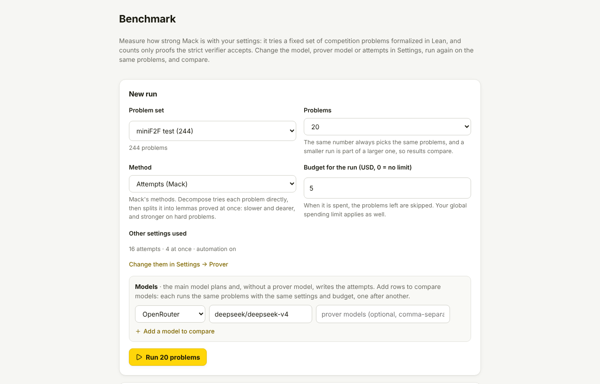
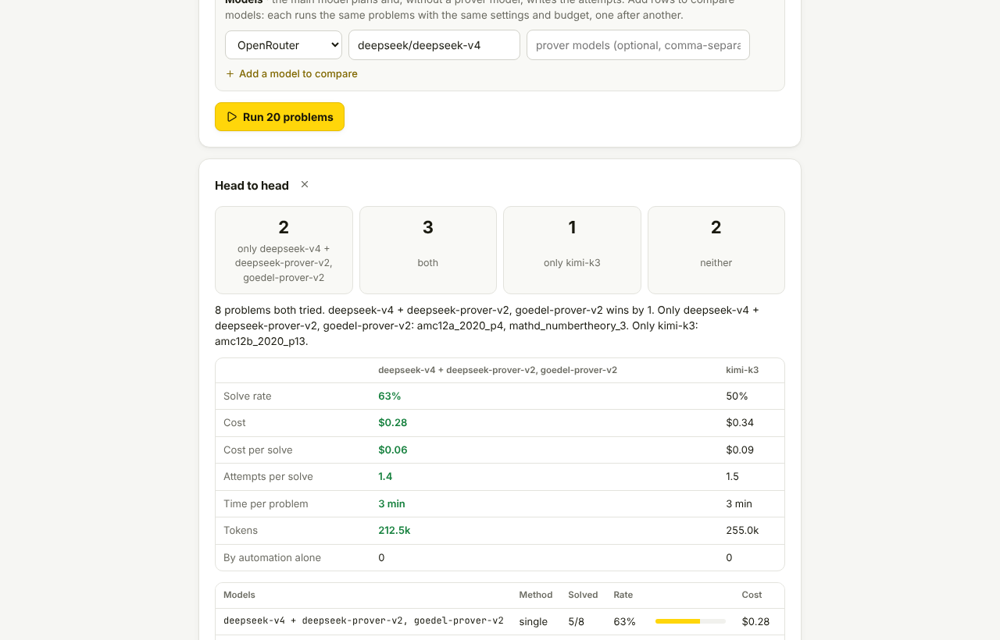

# Mack ⚡

<p align="center">
  <a href="https://github.com/JorgeOchoaReyes/Mack/releases/latest"><b>⬇ Download for Windows or Linux</b></a> ·
  <a href="https://jorgeochoareyes.github.io/Mack/"><b>Benchmark leaderboard</b></a> ·
  <a href="https://jorgeochoareyes.github.io/Mack/methodology.html">Methodology</a> ·
  <a href="#contributing">Contribute</a>
</p>

**A desktop app for math research where Lean has the last word.** Open models
propose proofs; Lean's kernel and a strict verifier decide whether they hold.
A model saying "proved" counts for nothing.

Mack brings the methods of
[Open Math Harness](https://github.com/openmathmodel/open-math-harness) (the
Linux-only runtime of Open Math OS) to an app for a personal Windows or Linux
machine, and adds a benchmark you can run yourself and publish.
[docs/UPSTREAM.md](docs/UPSTREAM.md) maps what is ported.

- [Features at a glance](#features-at-a-glance)
- [Proving methods](#proving-methods)
- [Benchmark](#benchmark)
- [How it works](#how-it-works)
- [Install](#install)
- [Contributing](#contributing)

## Features at a glance

| | Feature | What you get | Where |
|---|---|---|---|
| 🧮 | **Prove** | Write or open a Lean statement and watch every attempt, Lean's errors and the goals left, until the verifier accepts | Prove screen |
| 🔬 | **Research chat** | An agent that reads project files and PDFs, searches the web, runs Lean, and writes files or starts proofs after you approve each call | Chat screen |
| 📊 | **Benchmark** | miniF2F and PutnamBench, pass@k as the labs report it or Mack's own agent, locally or on cloud machines | Benchmark screen |
| 🌐 | **Public leaderboard** | Share a run as a pull request; CI re-checks every proof before it is published | [Site](https://jorgeochoareyes.github.io/Mack/) |
| 🧪 | **Construction search** | Evolves Python programs that build objects (counterexamples, configurations, better bounds), scored in a separate process | Chat |
| 📖 | **Walkthroughs** | Any accepted proof explained step by step in plain words, with every version kept | Walkthroughs screen |
| 🗂️ | **Proof-search runs** | Sets of problems, each with its own tree and journal, that can be stopped and resumed | Runs screen |
| 🧠 | **Project memory** | Mack writes a record of each chat and gives later chats a short index of the past | Automatic |
| 🔌 | **MCP and plugins** | Connect MCP servers (stdio or HTTP) and plugins, each with your approval | Chat |
| 🔍 | **Review and secret scan** | Projects are git repos; see every uncommitted change; likely credentials are masked | Review screen |
| ⚡ | **Fast checks** | A resident Lean REPL keeps Mathlib loaded, so a partial proof checks in seconds | Everywhere |
| 🛠️ | **One-click setup** | Installs Lean (elan) and a Mathlib workspace with its prebuilt cache | Setup screen |
| 🔄 | **Auto-update** | Installed copies update from GitHub Releases after every merge | Automatic |

**Model providers:** [Fireworks](https://fireworks.ai),
[OpenRouter](https://openrouter.ai),
[Cheaper Inference](https://www.cheaperinference.com) (Mack sends its model
lock, so a run is served by the model it names), a
[LiteLLM](https://docs.litellm.ai) proxy (its prices feed the spending limits),
or any OpenAI-compatible server (Ollama, LM Studio, vLLM). Each has its own key
and model, switchable per run. No key ships with Mack.

<details>
<summary><b>More of what the app does</b></summary>

- **One project for every screen.** Pick a folder once in the sidebar. Prove
  lists its `.lean` files and marks the ones changed since you looked; Chat
  works in the same folder; History and Runs show that project's runs.
- **Before the first attempt.** Lean's random tester (`plausible`) tries to
  break the statement, and a counterexample stops the run before any model
  call. Then Lean's automation (aesop, omega, nlinarith, …) tries to close it.
  What is left goes to a model, which plans the proof in words first.
- **A full agent in chat.** Streaming replies, a reasoning depth per chat,
  sub-agents, a shell and background commands (each approved), reminders,
  attached files and images, messages sent while it works, checkpoints for
  long chats, and project skills (`.skill/<name>/SKILL.md`).
- **History.** Every run is kept locally, with each attempt and what Lean said.
- **Upstream tracking.** On launch, Mack can check whether Open Math Harness
  changed its methods; you can stay on your version.

</details>

## Proving methods

Every method ends at the same strict verifier. Choose one on the Prove screen,
from chat, or for a benchmark run.

| Method | How it works | Best for | From |
|---|---|---|---|
| **Attempts** | The model writes a proof, Lean's errors go back, it revises; several chains at once, the first verified proof stops the rest | Most problems | Mack |
| **Decompose** | Splits the statement into lemmas proved in parallel, then assembles them | Long proofs with clear steps | Mack |
| **Research loop** | Rounds of: proof plans from different angles → a referee finds each plan's gap and keeps the best two → attempts and a lemma split worked at once → every lemma Lean accepts is offered to later attempts → re-plan with twice the budget | One hard problem | Mack |
| **Step by step** | Builds the proof one tactic at a time on Lean's live proof states | Tactic-heavy goals | Mack |
| **Search tree** | Parallel workers extend partial proofs (with `sorry`); Lean scores each and later rounds continue the most promising | Wide search | Open Math Harness |
| **Ultramath** | A swarm, each member on a direction no other holds, sharing a board of lemmas, counterexamples and dead ends | Open-ended problems | Open Math Harness |

### What counts as a proof

The strict verifier, ported from upstream, accepts a proof only if:

- the frozen statement appears word for word and the preamble is unchanged;
- it has no `sorry`, `axiom`, `native_decide`, `pp`/`debug` options or
  metaprogramming;
- Lean elaborates it, and it depends only on `propext`, `Classical.choice` and
  `Quot.sound`;
- its fully elaborated type matches the original statement exactly.

Final verification always runs in a fresh Lean process.

## Benchmark

Measure Mack with your models on the problems everyone uses, then publish the
result. Every proof on the leaderboard has been re-checked by CI with Lean.

<p align="center"></p>

### Problem sets

| Set | Problems | What it measures |
|---|---|---|
| [miniF2F test](https://github.com/openai/miniF2F) | 244 | Competition problems (AMC, AIME, IMO, MATH): the set the labs' provers report on |
| [PutnamBench](https://github.com/trishullab/PutnamBench) | 664 | Putnam problems since 1962: much harder, where the labs compete now |
| Recent Putnam (2024–2025) | 16 | The contamination check: problems least likely to be in a model's training data |

A given number of problems always picks the same problems, so runs of the same
size compare. Each problem's page on the site shows the problem in words, its
source, and the Lean statement the model was given.

### Protocols

| | **Pass@k** (default) | **Mack agent** |
|---|---|---|
| Measures | The model, as the labs report it | Mack as a system |
| Samples | Up to *k* independent samples from the opening prompt | Attempts that learn from Lean's errors |
| Help given | None: no automation, repairs, premise hints, plans or shared lemmas | All of Mack's procedures (each listed on the run) |
| Reply length | Up to 32k tokens | The model's usual limit |
| Compare with | Published pass@k numbers | Other Mack runs |

Both run several problems at once locally, and a pass@k problem runs up to 8
of its samples at once. The site ranks each protocol and size in its own table.

### Results

Live numbers are on the **[leaderboard](https://jorgeochoareyes.github.io/Mack/)**.
Runs published so far:

| Set | Problems | Model | Protocol | Solved |
|---|---|---|---|---|
| miniF2F test | 20 | `us/gpt-6.1-sol` | Mack agent, attempts | **20 / 20** |

<p align="center"></p>

### Three ways to run one

| | Where | Who | Published how |
|---|---|---|---|
| **In the app** | Your computer | Anyone | **Share as a PR** on the run, or turn on *open the PR when a run completes* |
| **Official cloud run** | Up to 20 free GitHub Actions machines in parallel | Repository owner | Opens the PR itself, marked **Official** on the site |
| **Headless CLI** | Any machine with Lean | Anyone | `node dist-electron/scripts/run-bench.js --set minif2f-test --problems 20 --method passk --attempts 32 …` |

An **official run** starts from *Actions → Official benchmark run → Run
workflow*. It splits the set across machines, joins the parts, and opens a pull
request for you to review: merge it to publish, close it to drop it. A run
whose budget ran out opens as a draft that says so. Its summary page shows the settings at once, each machine's
problems as they finish, and then the score, cost, failures and pull request.
It needs the provider's API key as a repository secret (`FIREWORKS_API_KEY`,
`OPENROUTER_API_KEY` or `CHEAPER_INFERENCE_API_KEY`) and, so the PR's checks
run, `MACK_BENCH_TOKEN`.

<p align="center">
  
  
</p>

Every run keeps each attempt's proof, Lean's verdict, the model's thinking,
tokens, cost and a timeline of every step. Open a run's **metrics**, or tick
two runs for a **head to head**.

### How far the numbers can be trusted

| Check | How |
|---|---|
| ✅ Solves are re-checked | CI re-verifies every solved proof with Lean and the strict verifier, against Mack's own copy of each problem and the recorded Mathlib. Editing `run.json` cannot add a solve |
| ✅ Nothing left out | A run must list every problem of its fixed sample; a skipped problem counts as unsolved |
| ✅ Ranges, not just rates | Each rate has its 95% range (13 of 20 is 43–82%) |
| ✅ Official runs are marked | Only the owner's cloud workflow, on a same-repo PR, can carry the Official badge |
| ✅ Contamination check | Recent Putnam is its own set, and PutnamBench runs are split by year |
| ⚠️ Self-reported | Cost, time, tokens and the served model come from the machine that ran it |

The [methodology page](https://jorgeochoareyes.github.io/Mack/methodology.html)
explains every set, protocol, method, limit and failure label.

## How it works

```
 your statement ──► plausible tries to break it ──► Lean automation tries to close it
                                                          │ not closed
                                                          ▼
                     model plans the proof in words ──► model writes a proof
                                                          │
          ┌───────────────────────────────────────────────┘
          ▼
   Lean checks it ──► errors and goals go back ──► revise, or start over ──┐
          ▲                                                                │
          └────────────────────────────────────────────────────────────────┘
          │ (or: decompose, research loop, step by step, search tree, Ultramath)
          ▼
   strict verifier: same statement, no sorry or extra axiom, Lean's kernel accepts
```

1. **A statement goes in.** You write it in Lean (or ask the chat to), and Mack
   freezes it: the proof must prove exactly that statement.
2. **Cheap things first.** A counterexample search and Lean's own automation,
   before any model call.
3. **Models propose.** One model or several (a planner and prover models),
   with any of the methods above. A Mathlib lemma name that does not exist is
   corrected when there is one clear match.
4. **Lean decides.** Only the strict verifier's verdict counts.

## Install

You need Windows 10 or 11, or 64-bit Linux (x86-64),
[Git](https://git-scm.com), about 10 GB of free disk, and your own model
provider key or a local OpenAI-compatible server.

From the [latest release](https://github.com/JorgeOchoaReyes/Mack/releases/latest):

- **Windows:** run `Mack-Setup-<version>.exe`. It installs for your user and
  adds Start-menu and desktop shortcuts.
- **Linux:** make `Mack-<version>.AppImage` executable and run it:

  ```bash
  chmod +x Mack-*.AppImage
  ./Mack-*.AppImage
  ```

  AppImages need FUSE 2 (`sudo apt install libfuse2`, or `libfuse2t64` on
  Ubuntu 24.04). Keys are stored in the system keyring when one is running.

Then follow **Setup** in the app:

1. **Lean and Mathlib:** click *Install* (5–20 minutes, about 5 GB).
2. **Provider and key:** pick a provider and paste your key. It is encrypted
   with the system's credential protection and sent only to that provider.
3. **Model:** pick one from your account's list.

Or build from source:

```bash
git clone https://github.com/JorgeOchoaReyes/Mack.git
cd Mack
npm install
npm run dist        # Windows: release/Mack-Setup-<version>.exe
npm run dist:linux  # Linux:   release/Mack-<version>.AppImage
```

## Development

```bash
npm start            # build and run without installing
npm test             # unit tests; no Lean or key needed
npm run typecheck
MACK_LEAN_WORKSPACE=~/mack-lean npm test   # also run the verifier against real Lean
npm run setup:lean   # the app's Lean setup, from the terminal
```

For development keys, copy `.env.example` to `.env` (gitignored) and set
`FIREWORKS_API_KEY`, `OPENROUTER_API_KEY`, `CHEAPER_INFERENCE_API_KEY` or
`CUSTOM_API_KEY`.

The code is in three parts: `core/` (prover, verifier, agent and benchmark,
without Electron), `electron/` (main process and IPC), and `src/` (the React
screens).

## Contributing

Three kinds of contribution need no code:

- **Share a benchmark run.** Run the Benchmark (20 problems is a good start)
  and press **Share as a PR**. Connect a GitHub account in Settings → GitHub
  with a [token](https://github.com/settings/tokens/new?scopes=repo&description=Mack)
  or `gh auth login`; Mack forks the repo when you cannot push to it. CI's
  *Benchmark runs* check must pass before it is merged.
- **Add a proof to the community library.** Put `Statement.lean` and
  `Proof.lean` in `community/proofs/<name>/` (see
  [community/README.md](community/README.md)). CI merges it only when the
  strict verifier accepts it.
- **Report where Mack loses.** Open an issue with a run's report, or use the
  Feedback screen in the app.

For code: branch from `main`, run `npm run typecheck` and `npm test`, add a
test for your change, and open a pull request against `main`. Nothing is pushed
to `main` directly; every merge publishes a release.

## Roadmap

- [x] Verified proving, one-click Lean setup, run history, Windows installer
- [x] Proof search tree and a resident Lean REPL
- [x] Ultramath swarms
- [x] Research chat with tools and memory
- [x] More providers: OpenRouter, Cheaper Inference, LiteLLM, any OpenAI-compatible server
- [x] Releases, auto-update and Linux AppImage ([docs/RELEASING.md](docs/RELEASING.md))
- [x] Public benchmark: pass@k, official cloud runs, CI-checked leaderboard
- [x] Research loop for hard problems
- [ ] A code-signed Windows installer (needs a certificate only the maintainer can obtain)

Not planned: upstream's capability microkernel and bubblewrap sandbox are
Linux-only. Mack limits each agent's tools inside the app instead, which is
weaker; the chat's *What it can do* panel states exactly what its agent can do.

## License

Apache-2.0. Adapts code from Open Math Harness (Apache-2.0); see NOTICE.
miniF2F informal statements © facebookresearch/miniF2F (MIT).
